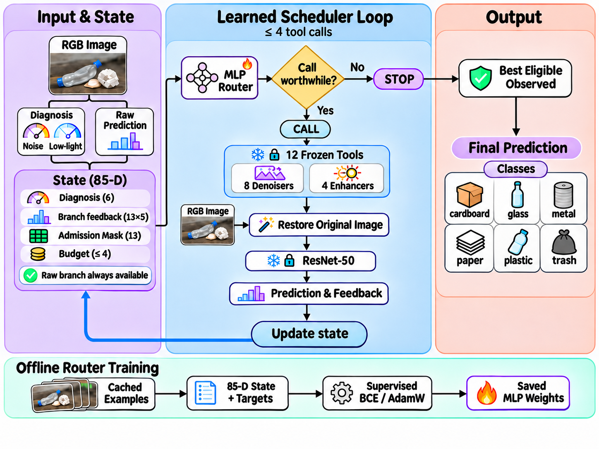

# Agent-Based Restoration Tool Scheduling for Waste-Image Classification

This agent schedules image restoration for six-class TrashNet classification. It starts with the raw prediction, then decides whether to call an admitted restoration tool or return the best eligible prediction it has observed. Each call processes the original image. The frozen ResNet-50 supplies feedback to the learned router, which can make up to four restoration calls.



## Run inference

Run these commands from the repository root with Python 3.10. Use a CUDA-enabled PyTorch build for GPU inference.

```sh
python -m pip install -r requirements.txt
python -m src.main --config config/iterative_agent_13tool.yaml --image /path/to/image.jpg --device cuda
```

Before running inference, place the seed 1 router, its paired classifier, and the restoration checkpoints under `weights/` at the paths listed in the [frozen manifest](results/frozen_manifest/frozen_manifest_13tool.json). The manifest records the SHA-256 of each file. Checkpoints and images are kept separately from the Git repository.

Run the unit tests with `python -m unittest discover -s tests`.

## Reported results

| Test setting | Raw accuracy | Agent accuracy |
| --- | ---: | ---: |
| Six scenes, 430 source images | 0.7093 | 0.7513 |
| Noise and low light, 430 source images | 0.6899 | 0.7798 |

The agent averages 0.79 restoration calls per image in the two-scene test. See the [scene table](results/final_figures/table2_13tool.md), [paired confidence intervals](results/final_figures/paired_ci_13tool.md), and [component ablations](results/final_figures/table6_ablation.md).

## Repository layout

| Path | Contents |
| --- | --- |
| `src/` | Agent, router, restoration tools, and classifier |
| `config/` | Frozen runtime configuration and tool definitions |
| `scripts/` | Dataset preparation, training, evaluation, and reporting |
| `tests/` | Unit tests |
| `data/splits/` | Source-image filenames and labels for the four TrashNet splits |
| `results/` | Aggregate results and checkpoint provenance |

See the [router and evaluation notes](docs/iterative_learned_router.md) for the state layout, checkpoint pairing, and a test-set evaluation command.
